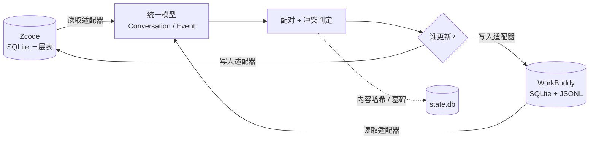

# AgentSync

把 **Zcode** 和 **WorkBuddy** 之间的**对话历史**与**全局记忆规则**保持双向一致的本地工具。

Windows · 纯 Python 标准库 · 无需任何第三方依赖 · 自带单文件 `exe`

---

## 它解决什么问题

这两个客户端各存各的数据，格式完全不同：

| | Zcode | WorkBuddy |
|---|---|---|
| 位置 | `~/.zcode/cli/db/db.sqlite` | `~/.workbuddy/workbuddy.db` + `~/.workbuddy/projects/<slug>/<id>.jsonl` |
| 结构 | `session` / `message` / `part` 三层表 | 一行 `sessions` 记录 + 一个 JSONL 事件流 |
| 正文 | `part.data` 按 `type` 分（text / reasoning / tool） | 每行一个事件（message / reasoning / function_call…） |
| 排序 | `message.sequence` + `part.sequence` | UUIDv7 的 `id` + `parentId` 链 |
| 全局规则 | `~/.zcode/AGENTS.md`，hook 每条消息注入 | `user-<账号>-personal/MEMORY.md` + 工作区 `.codebuddy/CODEBUDDY.md`，默认仅首轮注入 |

AgentSync 在中间做一层归一化：两边都读成同一套 `Conversation / Event` 模型，按规则判定谁更新，再按**对方原生的字段结构**写回去。



---

## 三个能力

**1. 对话双向同步**

- 一侧有、另一侧没有 → 补齐
- 两边都有 → 比最后活动时间，新的一侧整段覆盖旧的一侧
- 判定不了就不配对（宁可多一条，也不合并错）

**2. 全局记忆（规则）同步**

- Zcode `AGENTS.md` ⇄ WorkBuddy `MEMORY.md` ⇄ 权威副本 `state/memory/GLOBAL.md`
- 以 `##` 小节为单位做三方合并：你在 Zcode 加一条、在 WorkBuddy 改另一条，两边都保留
- 附一个 WorkBuddy 本地插件（`wb-plugin/`），让 WorkBuddy 侧也从「仅首轮注入」变成「每条消息注入」

**3. 一键修复打不开的会话**

- 体检并修好会让客户端崩溃的工具结果字段（详见 [技术文档](开发/README-技术文档.md#8-踩过的坑都已在代码里修掉)）
- 清理侧边栏里「列表能看到、点开是空的」幽灵条目

---

## 快速开始

### 方式 A：直接用 exe（推荐）

1. 下载 `AgentSync.exe`（Release 页或自行打包，见下）
2. **完全退出 Zcode**（关窗口不够，托盘图标右键 → 退出）
3. 双击 `AgentSync.exe`，**直接回车**（默认就是「一键同步」）

### 方式 B：源码运行

```bash
python 开发/run.py doctor          # 先体检：路径、进程、两边会话数
python 开发/run.py sync --dry-run  # 只看计划，不写任何东西
python 开发/run.py sync            # 真正同步（自动备份）
```

Python 3.8+ 即可，只用标准库。3.8 与 3.13 都实测通过。

### 配置（可选）

不配也能跑 —— 所有项都有内置默认值。需要改的话：

```bash
cp config.example.json config.json   # 然后按需修改
```

唯一值得配的是 `workspaces`：给每个工作区指定两侧各自的目录，让同名工作区真正落到一处。

```json
"workspaces": {
  "日常项目": {
    "zcode": "D:\\你的目录\\日常项目",
    "wb":    "C:/Users/<你>/WorkBuddy/日常项目"
  }
}
```

留空则自动推断（取该侧最近活跃会话所在目录）。

---

## 菜单（双击 exe 后）

| 选项 | 名称 | 什么时候用 |
|:--:|---|---|
| **1** | 一键同步 | 平时就用这个 |
| 2 | 查看状态 | 两边各有多少对话、有没有配对成功 |
| 3 | 体检 | 感觉不对时先跑：只检查，不改任何东西 |
| 4 | 修复打不开的会话 | 点开是空白，或弹出 `Received undefined` |
| 5 | 立即备份 | 手动存一份（同步前本来就会自动备份） |
| 6 | 历史备份 | 看存过哪些备份、放在哪 |
| 0 | 退出 | |

**日常记一句就够：平时按 1，出事按 4。**

---

## 安全设计

这个工具会直接写两个客户端的数据库，所以默认行为一律偏保守：

- **同步前自动快照**：用 SQLite 在线备份接口（WAL 模式下直接拷文件会撕裂），存到 `state/backups/<时间戳>/`
- **覆盖前留存原始行**：被覆盖的 Zcode 会话整份导出成 JSON，可原样回滚
- **Zcode 运行时拒绝写它的库**：它持有连接和内存状态，退出时可能把改动覆盖回去。要强行写入加 `--force-open`（风险自负）
- **删除默认只报告、不传播**：一侧删了，另一侧只提示。要严格一致才加 `--delete`
- **墓碑防复活**：你删掉的对话不会被下一次同步当成「缺失」又搬回来
- **正在进行的对话只读不写**：可以把它同步到另一侧，但永远不往里面写

---

## 目录结构

```
AgentSync/
├── AgentSync.exe            双击运行（不入库，自行打包）
├── 使用说明.md              面向普通用户的操作说明
├── config.example.json      配置模板：复制成 config.json 后按需修改
├── .agentsync-root          根目录标记（源码模式靠它定位项目根）
├── wb-plugin/               WorkBuddy「每轮注入全局记忆」本地插件
├── state/                   运行时数据（不入库）
│   ├── state.db             配对映射 / 内容哈希 / 墓碑
│   ├── memory/GLOBAL.md     规则权威副本
│   └── backups/             数据库快照与规则备份（保留最近 5 份）
├── logs/                    运行日志（不入库）
└── 开发/                    源码
    ├── run.py               命令行入口
    ├── launcher.py          exe 的中文菜单入口
    ├── selftest.py          42 项沙盒自测
    ├── install_wb_hook.py   注册 WorkBuddy 每轮注入插件
    ├── 重新打包.bat          一键重建 exe
    ├── README-技术文档.md     架构、信封格式、踩坑记录
    └── asynclib/
        ├── paths.py         路径与配置
        ├── model.py         统一模型 / 指纹 / 输出归一化
        ├── state.py         配对映射 / 墓碑 / 基线哈希
        ├── zcode.py         Zcode 读写适配器（含体检与修复）
        ├── workbuddy.py     WorkBuddy 读写适配器
        ├── sync.py          配对 + 冲突判定 + 计划 + 执行
        ├── memory.py        规则双向同步 + 三方合并
        └── console.py       Windows 控制台 UTF-8
```

---

## 开发

```bash
# 自测：42 项，全部跑在 state/selftest 的库副本上，不碰真实数据
python 开发/selftest.py

# 重建 exe（需要 PyInstaller）
开发\重新打包.bat
```

改代码前请先读 [开发/README-技术文档.md](开发/README-技术文档.md) —— 里面记着 Zcode 的严格信封格式、
哪些字段少一个就会让会话变空白，以及同步幂等性的两条硬约束。给 AI 协作者看的约定在 [AGENTS.md](AGENTS.md)。

---

## 已知限制

1. **同步后要重启客户端**：两边都把会话列表缓存在内存里，不重启看不到新会话（数据本身是好的）
2. **WorkBuddy 有云端同步**：新建会话会被它 import 到云端，UI 里删除也走云端接口；本工具只动本地库
3. **Zcode 运行时不写它的库**（默认），想两侧完全一致就先退出 Zcode
4. **已归档/已删除的会话不参与同步**：Zcode 的归档状态只记在 `tasks-index.sqlite` 的 `archived` / `deleted` 列
5. **规则有长度上限**：WorkBuddy 用户级 `MEMORY.md` 约 4000 字符、工作区 `CODEBUDDY.md` 约 8000 字节，超了会被截断
6. **只测过 Windows**：路径归一化、控制台编码、注册表都按 Windows 写的

---

## 声明

Zcode、WorkBuddy 均为第三方闭源客户端，本项目与它们的官方无关，仅通过读写本地数据文件实现同步。
使用前请自行备份；因误操作导致的数据损失，作者不承担责任。
